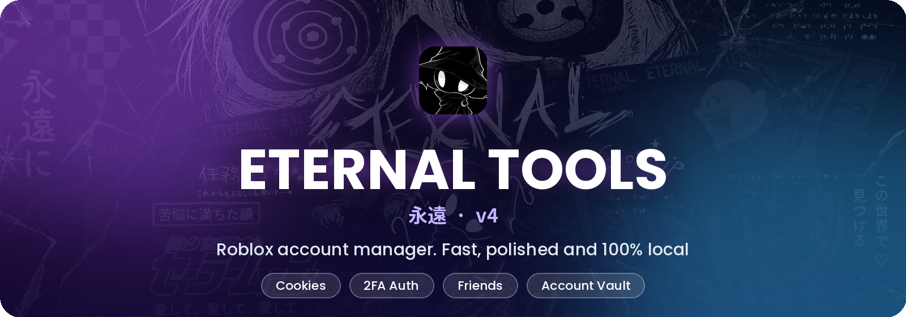
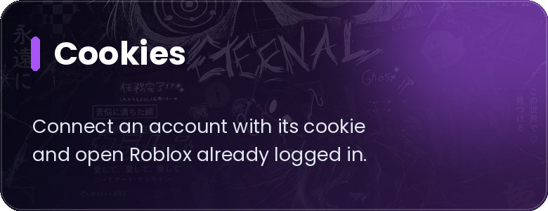
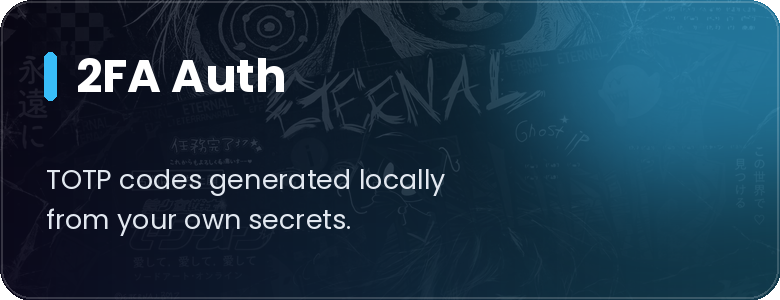
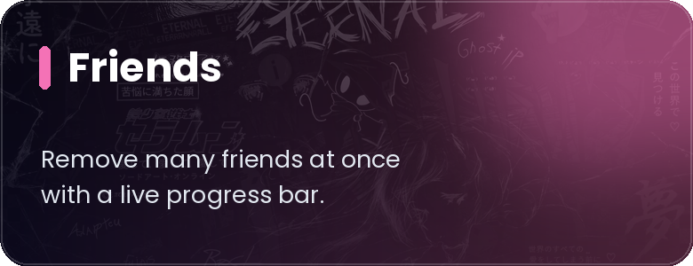
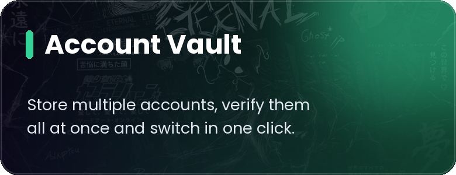
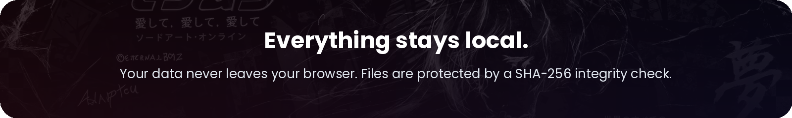

  

 

 

🌐 **English** · [Português](README.pt-BR.md)

**[Features](#-features)** · **[Installation](#-installation)** · **[Security](#-security-and-privacy)** · **[Disclaimer](#-disclaimer)**

 

## ✨ Features

 

> 🎨 **Settings:** themes, background particles, streamer mode, wallpaper dimming, skip the intro animation and more. Open them from the extension icon in the menu.

 

## 📥 Installation

Download the `.zip` from the **[Releases](../../releases/latest)** page and extract it into a folder.

<b>💻 PC (Chrome, Edge, Brave)</b>

 

1. Open `chrome://extensions`
2. Turn on **Developer mode**
3. Click **Load unpacked** and select the extracted folder (the one that contains `manifest.json`)

<b>📱 Android (Kiwi Browser)</b>

 

1. Open `kiwi://extensions` and turn on **Developer mode**
2. Tap **+ (from .zip/.crx/.user.js)** and choose the downloaded `.zip`

 

## 🔒 Security and privacy

 

- **Everything is local:** your data stays in your browser's own storage. Nothing is sent to any project server, and the extension only talks to Roblox.
- **Integrity check (SHA-256):** the extension verifies its own files. If any file is modified, it blocks itself and asks you to reinstall the original version.
- **Always download from the official [Releases](../../releases/latest) page.**

> [!WARNING]
> **Never share your `.ROBLOSECURITY` cookie with anyone.** It gives full access to your account.

 

## ⚖️ Disclaimer

Independent project, not affiliated with Roblox Corporation.

 

Made with 💜 by **[eternalBMZ](https://www.youtube.com/@eternalBMZ)**

永遠

