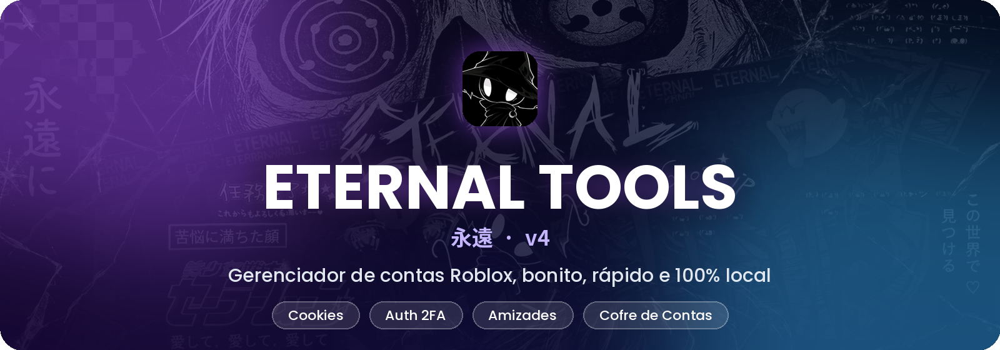
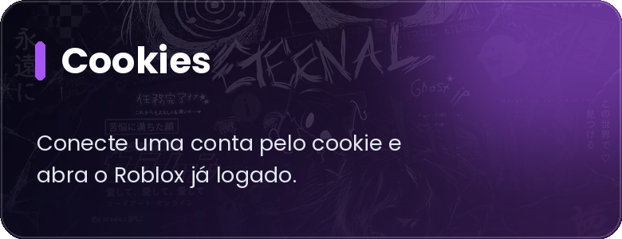
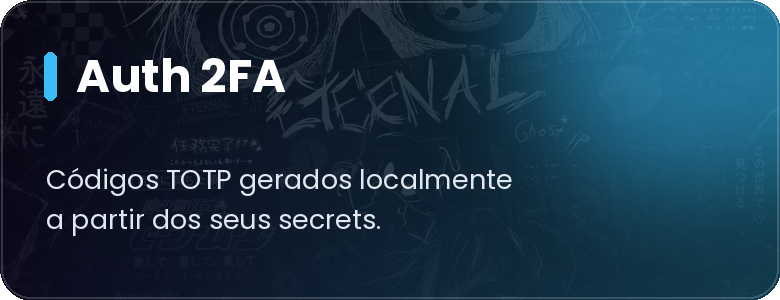
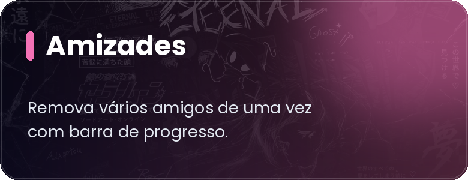
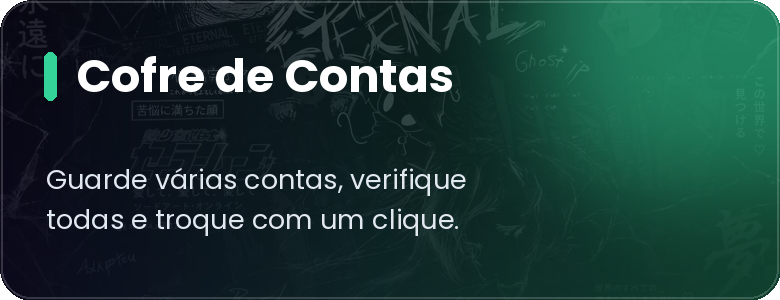
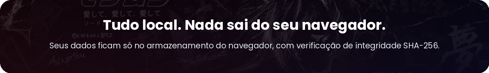

  

 

 

🌐 [English](README.md) · **Português**

**[Funcionalidades](#-funcionalidades)** · **[Instalação](#-instalação)** · **[Segurança](#-segurança-e-privacidade)** · **[Aviso legal](#-aviso-legal)**

 

## ✨ Funcionalidades

 

> 🎨 **Configurações:** temas, partículas de fundo, modo streamer, escurecer o wallpaper, pular a animação de abertura e mais. Tudo pelo ícone da extensão no menu.

 

## 📥 Instalação

Baixe o `.zip` na página de **[Releases](../../releases/latest)** e extraia em uma pasta.

<b>💻 PC (Chrome, Edge, Brave)</b>

 

1. Abra `chrome://extensions`
2. Ative o **Modo do desenvolvedor**
3. Clique em **Carregar sem compactação** e selecione a pasta extraída (a que contém o `manifest.json`)

<b>📱 Android (Kiwi Browser)</b>

 

1. Abra `kiwi://extensions` e ative o **Modo do desenvolvedor**
2. Toque em **+ (from .zip/.crx/.user.js)** e escolha o `.zip` baixado

 

## 🔒 Segurança e privacidade

 

- **Tudo local:** os dados ficam apenas no armazenamento do seu navegador. Nenhum dado é enviado a servidores do projeto.
- **Verificação de integridade (SHA-256):** a extensão confere os próprios arquivos. Se algum for alterado, ela bloqueia o uso e pede a reinstalação da versão original.
- **Baixe sempre pela página oficial de [Releases](../../releases/latest).**

> [!WARNING]
> **Nunca compartilhe seu cookie `.ROBLOSECURITY` com ninguém.** Ele dá acesso total à sua conta.

 

## ⚖️ Aviso legal

Projeto independente, sem afiliação com a Roblox Corporation.

 

Feito com 💜 por **[eternalBMZ](https://www.youtube.com/@eternalBMZ)**

永遠

